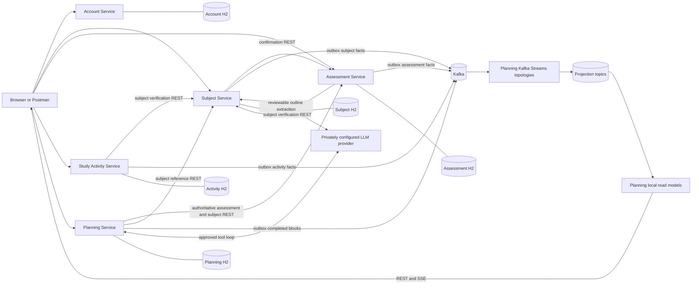
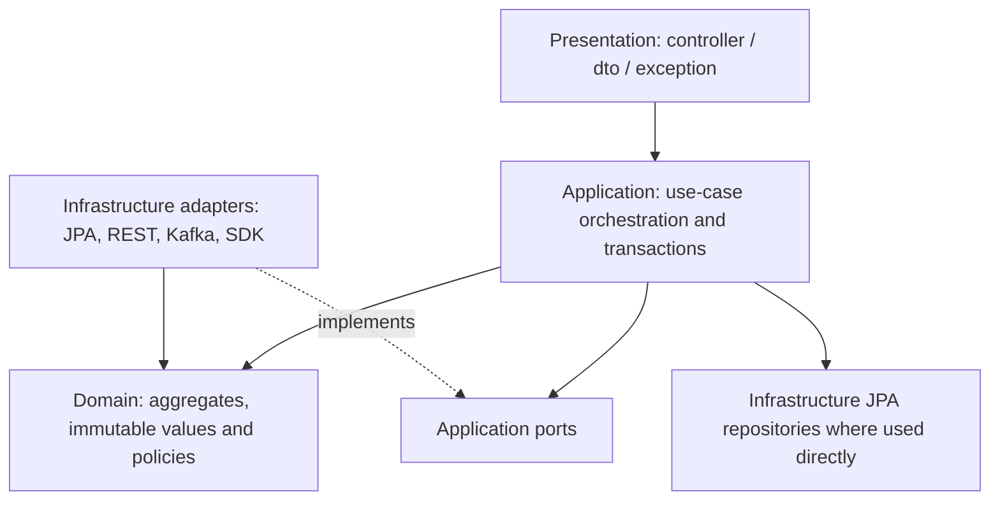
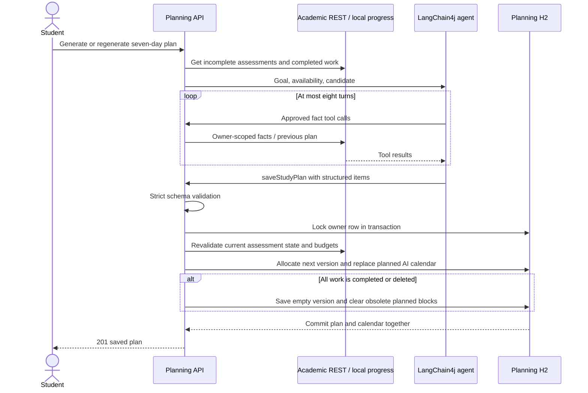

# Architecture and layer diagrams

All protected services validate the bearer token through Account REST (omitted from the drawing to keep business flows readable). No real key is sent to the browser or stored in a source file. Read-model queries use local Planning data; authentication still depends on Account.

The same four responsibilities are present in all five services. Subject uses explicit stores/gateways/reader/extraction ports; Planning uses PlanningTools, ProjectionStore and CalendarReferences. Some application-to-repository dependencies are direct and domain entities carry JPA annotations. This is a deliberate four-layer prototype, not a claim of perfectly inverted clean architecture.

An invalid model plan does not mutate plan/calendar state. The model cannot directly write the database. Provider failures return safe 503 errors; invalid input/output constraints return 400. Plan lock contention may return a retryable conflict rather than committing inconsistent versions.
