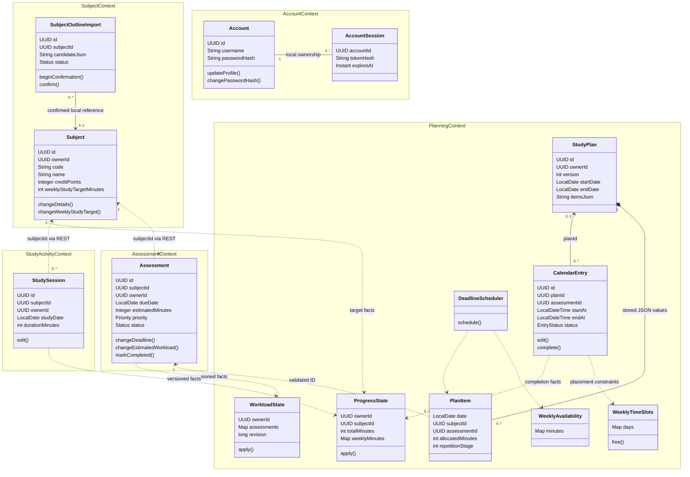

# Implemented domain model

This repository artefact describes the implemented prototype. It supports, but does not replace, the team's own assessed analysis. UUID links across contexts are logical references, not cross-database JPA relationships.

## Pattern responsibilities and ownership

| Pattern | Concrete implementation | Responsibility |
|---|---|---|
| Entity / aggregate root | Subject, Assessment, StudySession, StudyPlan, CalendarEntry, Account | Stable UUID identity; own persistence/lifecycle boundary; domain methods guard state changes |
| Value object | WeeklyAvailability, WeeklyTimeSlots.Window/Interval, PlanItem | Values describe availability and allocations; availability constructors validate invariants; submitted PlanItem values are validated at the application boundary |
| Domain service | DeadlineScheduler, WorkloadClassification | Scheduling and progress/workload policies separated from HTTP/LLM transport |
| Domain/integration event | SubjectCreated/TargetChanged, AssessmentCreated/Updated/Completed, StudySessionRecorded, StudyBlockCompleted | Committed facts with owner, aggregate ID and revision; dispatched through a transactional outbox |
| Read model | WorkloadState, ProgressState, ProjectionDocument | Derived state owned by Planning; not the authoritative academic aggregates |
| Infrastructure coordination | planning_owner_locks, unique owner/version index | Serialize plan/calendar commits and protect version uniqueness; not a business bounded context |

Each microservice owns its H2 database. `messaging-support` supplies technical outbox tables in each producer's database. It does not share a database or academic entities. PlanItem is stored as JSON within StudyPlan, while CalendarEntry has its own editable lifecycle. Owner IDs refer to Account through authentication; domain services never read the Account database.
