# Legacy 18-operation API examples (historical)

> Archived operation-level examples from before the final report consolidated the user stories into 14 broader cases. **Do not use these legacy FR/UC numbers as the final assessment's requirement IDs.** The original descriptions and request/response/flow examples follow unchanged.

# Functional use cases and activity diagrams

These eighteen use cases describe the implemented system, including failure paths. Actor: an authenticated student, except stream stories where the originating student command triggers asynchronous processing. All IDs are owned by the authenticated account. Preconditions: required services available; Kafka for projections; a private provider key for live AI stories. Fixture-based verification needs no private key.

Base variables and date setup are defined in the Postman collection. Paths here use its variables. `planBody` is `{"startDate":"2026-10-12","dailyAvailabilityMinutes":{"2026-10-12":60}}` with dates changed to the demonstration week. For exact slots include `availabilitySlots` with matching minute totals. Updates use complete update DTOs; omitted nullable fields can be cleared.

For FR-13, `GET {{activityBase}}/study-sessions/summary?subjectId={{subjectId}}&weekOf={{weekStart}}` also returns the authoritative activity-only weekly summary. Planning totals additionally include completed subject-linked calendar blocks. Do not record the same work through both mechanisms unless two separate sessions occurred.

## UC-01 / FR-01: Create subject

**Request:** `POST {{subjectBase}}/subjects`

**Input:** `{"code":"CSCI318","name":"Software Engineering","creditPoints":6,"weeklyStudyTargetMinutes":300,"assessments":[]}`

**Success/postcondition:** 201 with subject id.

**Flow:** Validate fields and nested candidates → Save subject and enqueue subject fact → Import optional assessments through REST.

**Alternate/error flow:** Invalid or null candidate: 400; upstream import failure: 503 with retryable confirmation semantics.

**Code:** SubjectApplicationService / SubjectConfirmationTransactions. **Evidence:** HTTP create subject and null nested input regressions.

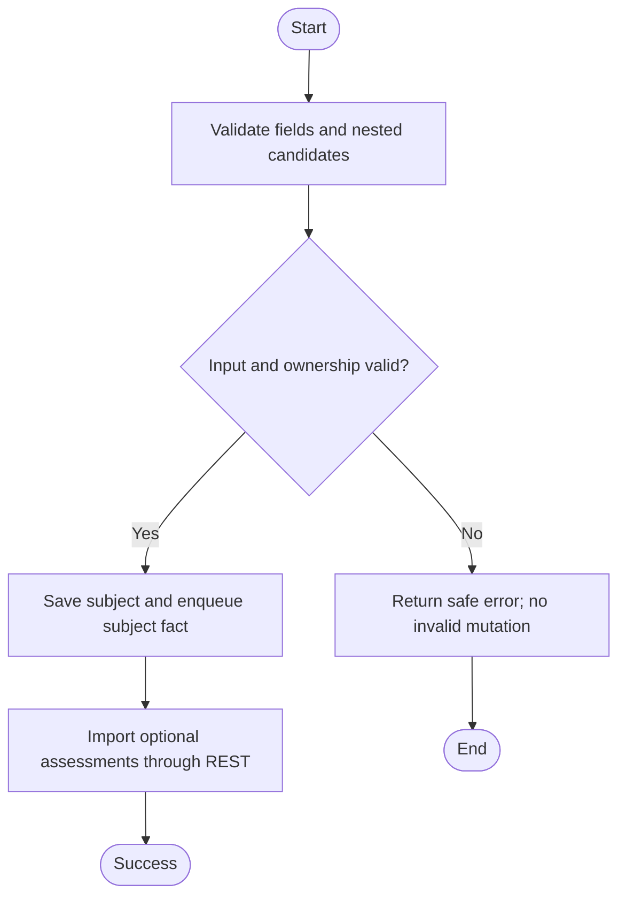

## UC-02 / FR-02: Retrieve subject

**Request:** `GET {{subjectBase}}/subjects/{{subjectId}}`

**Input:** `—`

**Success/postcondition:** 200 owned subject.

**Flow:** Validate bearer token → Find subject by owner and id → Return current subject.

**Alternate/error flow:** Missing or foreign id: 404.

**Code:** SubjectApplicationService.one. **Evidence:** Postman FR-02 and ownership API tests.

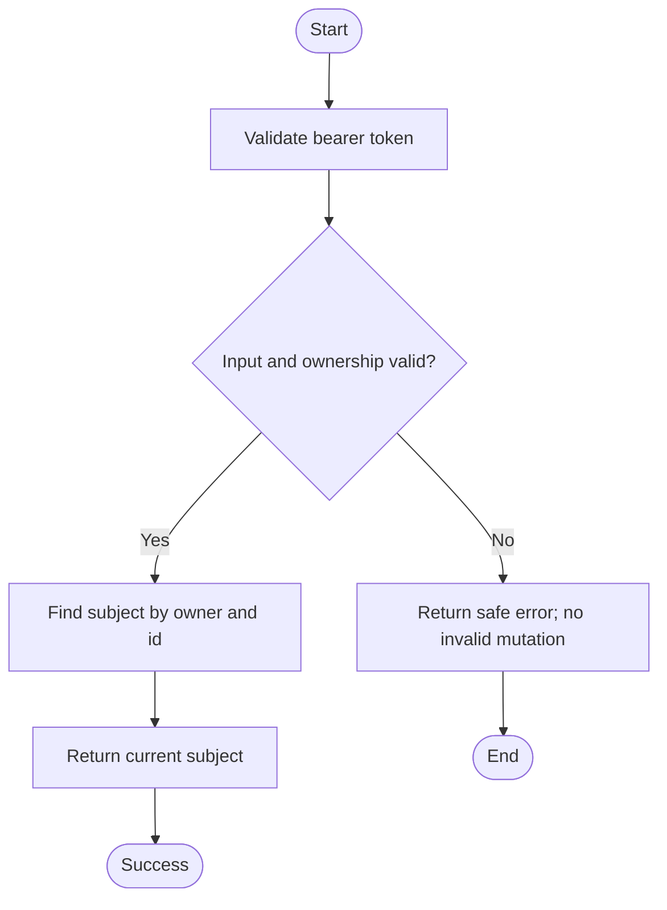

## UC-03 / FR-03: List subjects

**Request:** `GET {{subjectBase}}/subjects`

**Input:** `—`

**Success/postcondition:** 200 array; empty array is valid.

**Flow:** Resolve account → Query owned subjects → Return subject list.

**Alternate/error flow:** Invalid session: 401.

**Code:** SubjectApplicationService.all. **Evidence:** Postman FR-03; HTTP creation/readback.

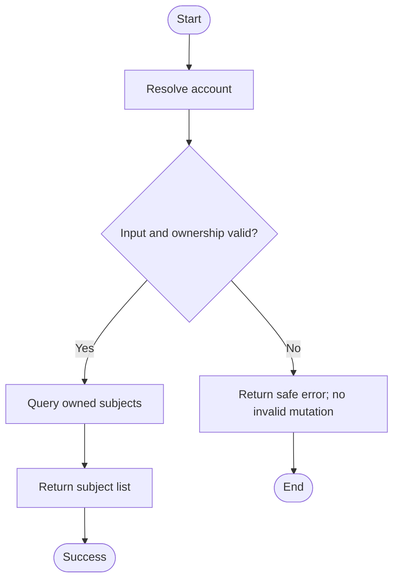

## UC-04 / FR-04: Update subject and weekly target

**Request:** `PATCH {{subjectBase}}/subjects/{{subjectId}}/study-target`

**Input:** `{"minutes":300}`

**Success/postcondition:** 200 with weeklyStudyTargetMinutes=300.

**Flow:** Validate target range → Load owned aggregate and apply change → Commit subject and outbox target event.

**Alternate/error flow:** Null/negative/excessive target: 400; foreign id: 404.

**Code:** SubjectConfirmationTransactions.changeTarget/update. **Evidence:** HTTP target tests; Postman edit and target requests; target stream CI.

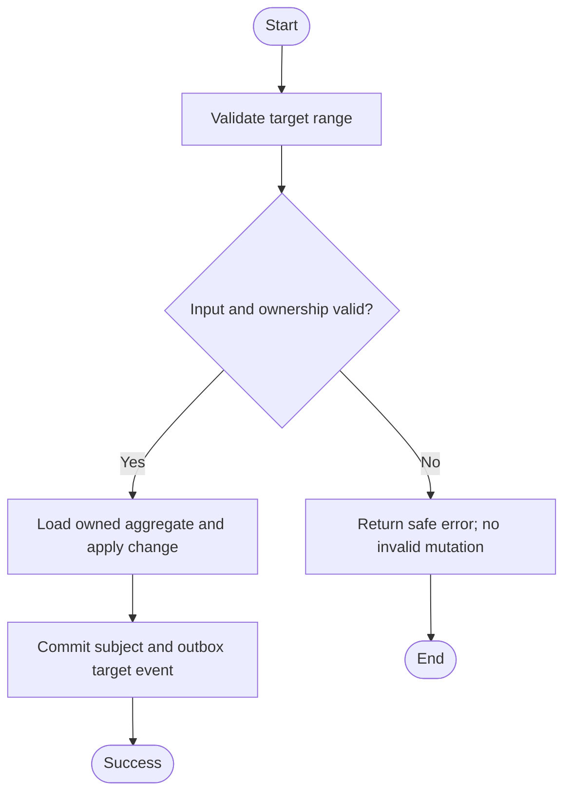

## UC-05 / FR-05: Create assessment for a subject

**Request:** `POST {{assessmentBase}}/assessments`

**Input:** `{"subjectId":"{{subjectId}}","title":"Report","type":"Report","weighting":40,"dueDate":"{{dueDate}}","estimatedMinutes":120,"priority":"HIGH"}`

**Success/postcondition:** 201 with assessment id.

**Flow:** Validate request → Verify subject ownership through REST → Commit assessment and outbox fact.

**Alternate/error flow:** Unknown subject/negative work/null import item: 400; Subject unavailable: 503.

**Code:** AssessmentApplicationService.create/importAll. **Evidence:** HTTP assessment and invalid reference tests; Postman Create assessment.

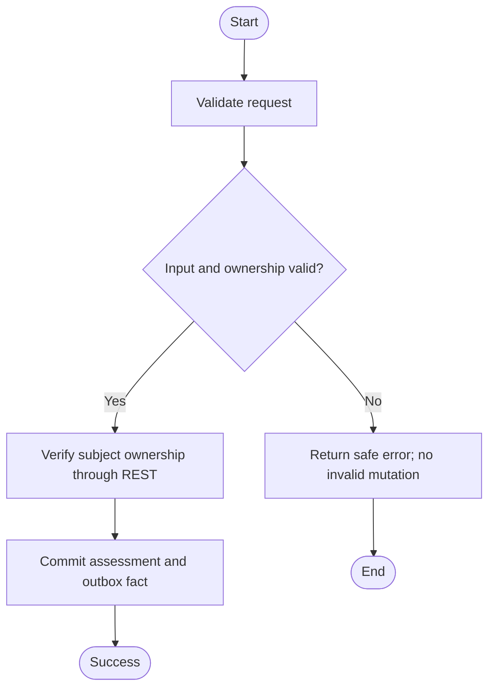

## UC-06 / FR-06: List all assessments

**Request:** `GET {{assessmentBase}}/assessments`

**Input:** `—`

**Success/postcondition:** 200 owned assessment array.

**Flow:** Resolve account → Query assessments ordered by due date → Return complete and incomplete records.

**Alternate/error flow:** Invalid session: 401.

**Code:** AssessmentApplicationService.all. **Evidence:** Postman FR-06; HTTP list/readback.

## UC-07 / FR-07: List incomplete assessments

**Request:** `GET {{assessmentBase}}/assessments?status=INCOMPLETE&subjectId={{subjectId}}`

**Input:** `—`

**Success/postcondition:** 200 incomplete owned assessments.

**Flow:** Resolve account → Filter by status and optional subject → Return matching assessments.

**Alternate/error flow:** Empty result is valid; invalid session: 401.

**Code:** AssessmentApplicationService.all / RestPlanningData. **Evidence:** Postman FR-07; planning tool tests.

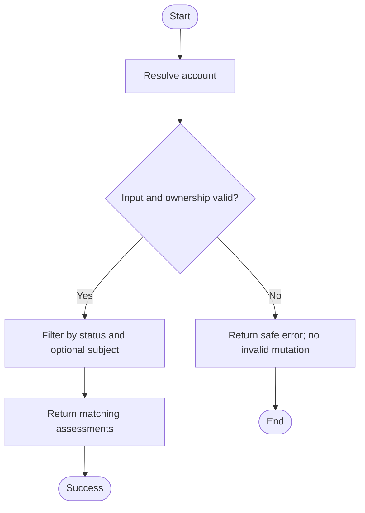

## UC-08 / FR-08: Change assessment deadline

**Request:** `PATCH {{assessmentBase}}/assessments/{{assessmentId}}`

**Input:** `{"title":"Report","type":"Report","weighting":40,"dueDate":"{{changedDueDate}}","estimatedMinutes":120,"priority":"HIGH"}`

**Success/postcondition:** 200 with changed dueDate.

**Flow:** Validate full update payload → Apply deadline and increment revision → Commit update fact for workload stream.

**Alternate/error flow:** Malformed date: 400; missing/foreign id: 404.

**Code:** Assessment.updateDetails/changeDeadline. **Evidence:** HTTP changed-state regeneration; Postman Change deadline.

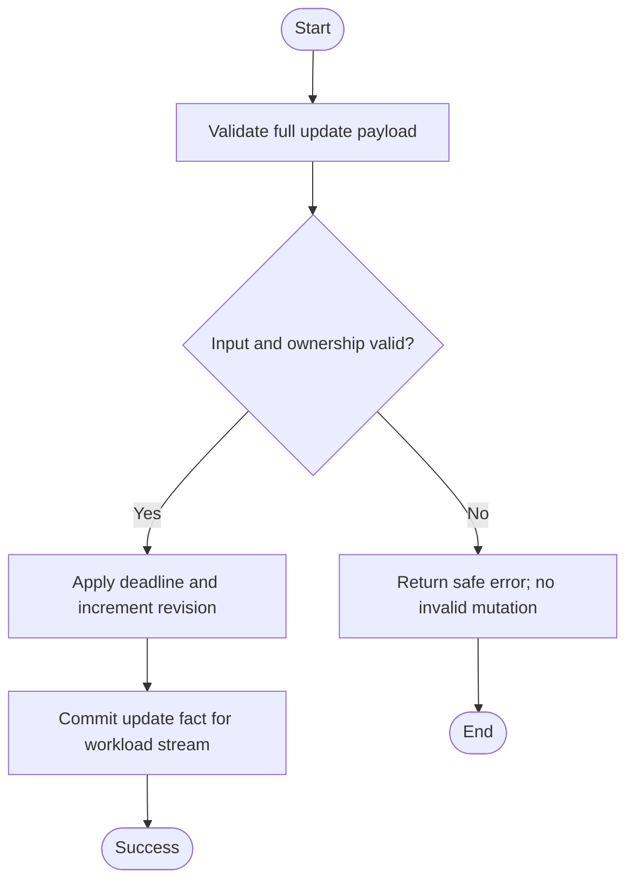

## UC-09 / FR-09: Change estimated workload

**Request:** `PATCH {{assessmentBase}}/assessments/{{assessmentId}}`

**Input:** `{"title":"Report","type":"Report","weighting":40,"dueDate":"{{dueDate}}","estimatedMinutes":0,"priority":"HIGH"}`

**Success/postcondition:** 200 with estimatedMinutes=0.

**Flow:** Validate nonnegative estimate → Apply aggregate change → Publish update and use new estimate in next plan.

**Alternate/error flow:** Negative estimate: 400; zero is explicit no-work, null is unknown/default 120 in planning.

**Code:** Assessment.changeEstimatedWorkload / DeadlineScheduler. **Evidence:** HTTP explicit-zero and negative tests; Postman changed estimate.

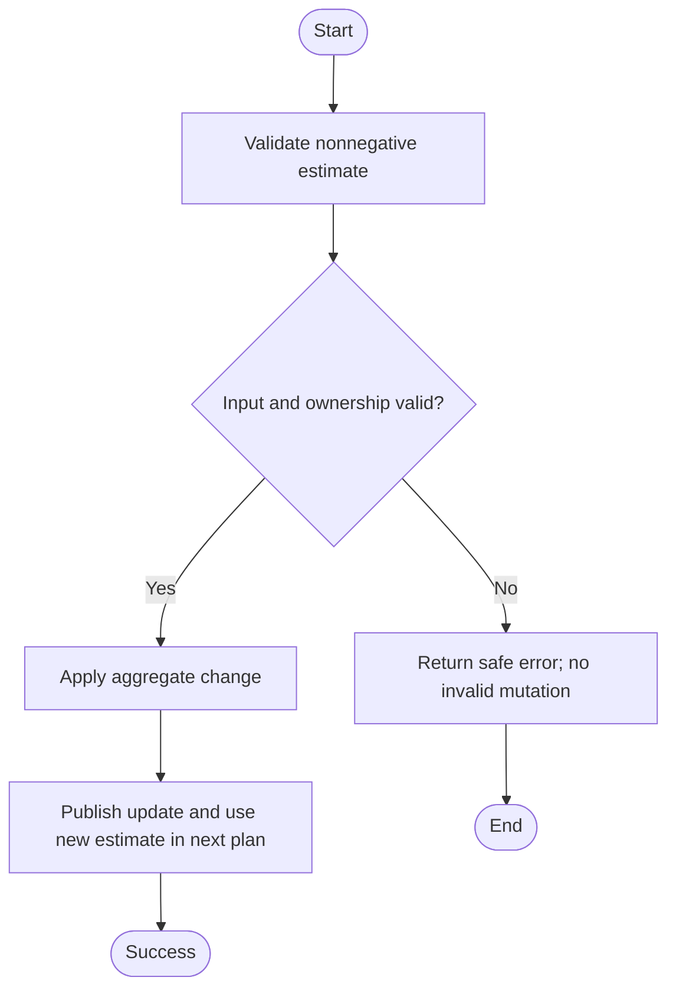

## UC-10 / FR-10: Complete assessment

**Request:** `POST {{assessmentBase}}/assessments/{{assessmentId}}/complete`

**Input:** `—`

**Success/postcondition:** 200 status COMPLETED.

**Flow:** Load owned assessment → Guard lifecycle transition → Commit completion fact for workload stream.

**Alternate/error flow:** Already completed: 400; missing/foreign: 404.

**Code:** Assessment.markCompleted / AssessmentApplicationService.complete. **Evidence:** Real-Kafka completion; HTTP complete-final-assessment; Postman completion.

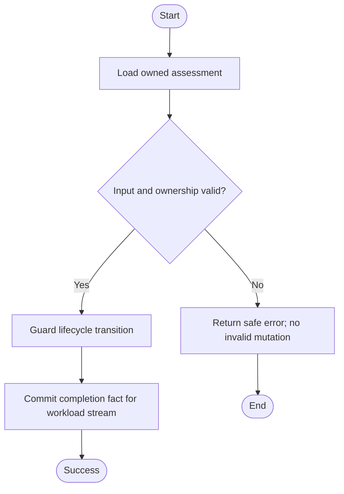

## UC-11 / FR-11: Record completed study session

**Request:** `POST {{activityBase}}/study-sessions`

**Input:** `{"subjectId":"{{subjectId}}","studyDate":"{{today}}","durationMinutes":45,"description":"Reviewed architecture"}`

**Success/postcondition:** 201 study session.

**Flow:** Validate date and duration → Verify subject through REST → Commit session and outbox event.

**Alternate/error flow:** Future/missing date, invalid duration or foreign subject: 400; dependency outage: 503.

**Code:** StudyActivityApplicationService.record / StudySession. **Evidence:** HTTP field limits, dates and ownership; Postman Record session.

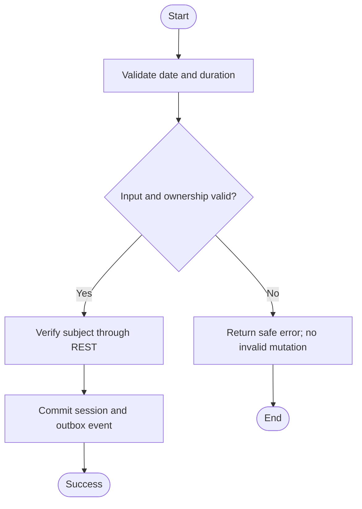

## UC-12 / FR-12: List sessions for selected subject

**Request:** `GET {{activityBase}}/study-sessions?subjectId={{subjectId}}`

**Input:** `—`

**Success/postcondition:** 200 owner/subject filtered array.

**Flow:** Resolve account → Filter owned sessions by subject → Return newest study dates first.

**Alternate/error flow:** Empty result is valid.

**Code:** StudyActivityApplicationService.all. **Evidence:** Postman FR-12; activity API tests.

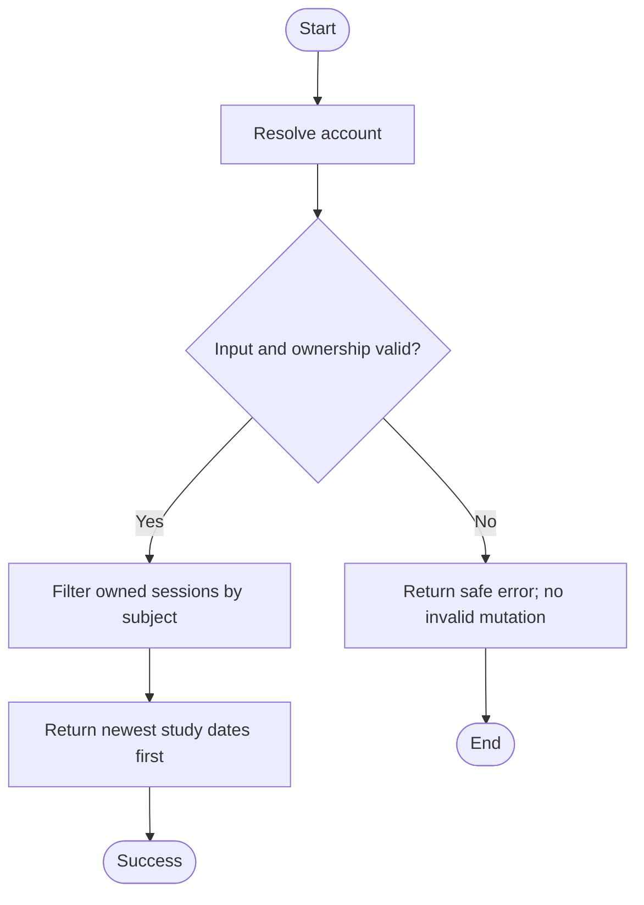

## UC-13 / FR-13: Calculate total and weekly duration

**Request:** `GET {{planningBase}}/progress/{{subjectId}}?weekOf={{weekStart}}`

**Input:** `—`

**Success/postcondition:** 200 totalMinutes, studiedMinutes and targetMinutes.

**Flow:** Resolve account and requested week → Read local subject progress projection → Return total and Monday-to-Sunday weekly metrics.

**Alternate/error flow:** Projection not yet available: retry after events converge; absent subject projection: 404.

**Code:** DashboardQueryService.progress / ProgressState. **Evidence:** Postman FR-13; real-Kafka corrections and weekly movement.

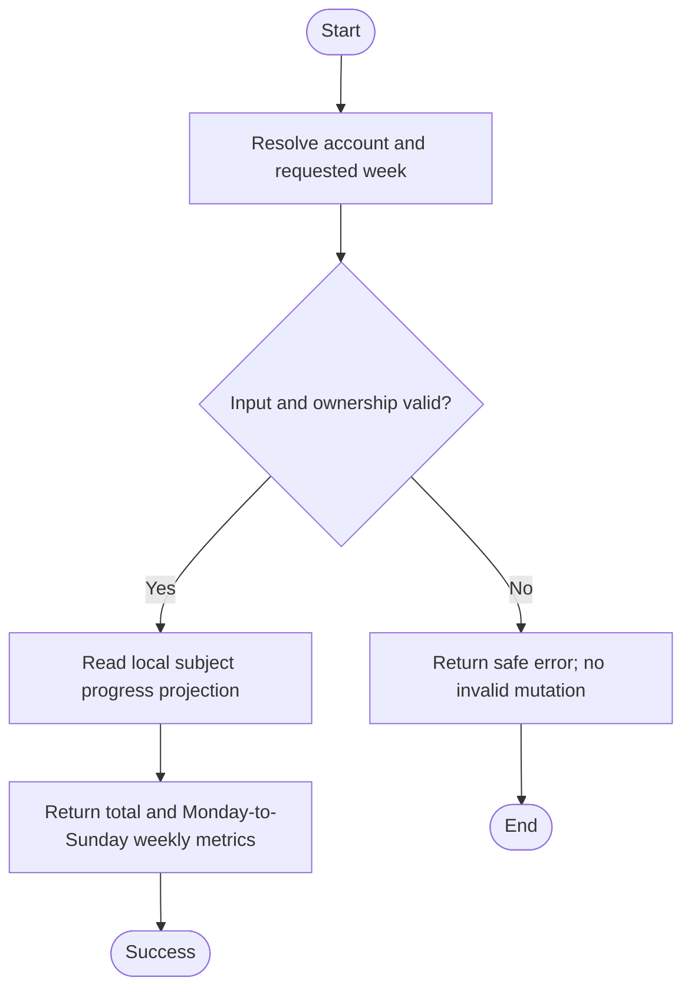

## UC-14 / FR-14: Update workload from assessment events

**Request:** `GET {{planningBase}}/workload`

**Input:** `—`

**Success/postcondition:** 200 incompleteAssessments, dueWithinSevenDays and workload status.

**Flow:** Commit assessment command and outbox fact → Validate and aggregate latest keyed revision in Kafka Streams → Persist projection and expose REST/SSE snapshot.

**Alternate/error flow:** Duplicate/stale revisions ignored; invalid envelopes quarantined; queries eventually consistent.

**Code:** PlanningStreamTopology.workload / WorkloadState. **Evidence:** Topology tests, real-Kafka CI and Postman RT-01 polling.

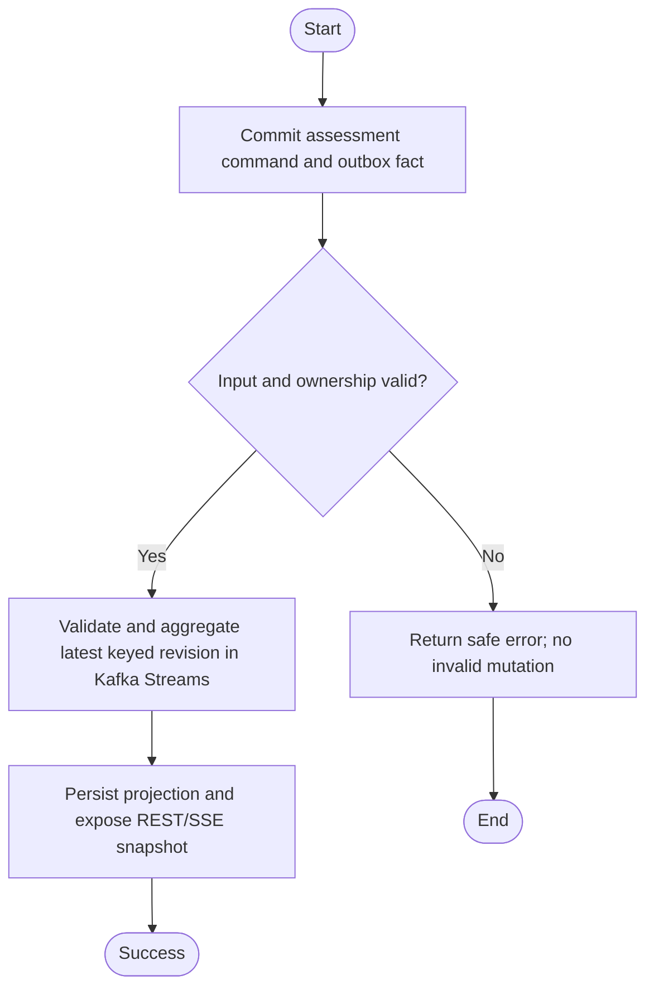

## UC-15 / FR-15: Update study progress from events

**Request:** `GET {{planningBase}}/progress/{{subjectId}}?weekOf={{weekStart}}`

**Input:** `—`

**Success/postcondition:** 200 total/weekly minutes and target state.

**Flow:** Consume activity and subject target facts → Replace session revisions and aggregate weeks → Persist progress and push dashboard update.

**Alternate/error flow:** Corrections replace, deletion subtracts, replay does not double count.

**Code:** PlanningStreamTopology.progress / ProgressState. **Evidence:** Topology tests, real-Kafka CI and Postman RT-02 polling.

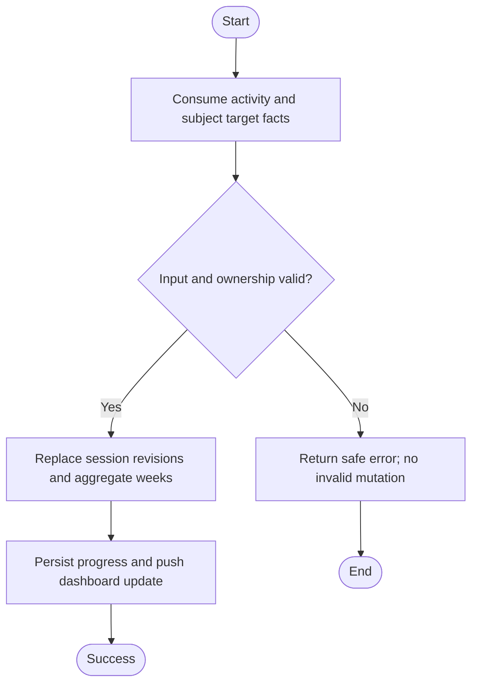

## UC-16 / FR-16: Generate seven-day plan

**Request:** `POST {{planningBase}}/plans`

**Input:** `{{planBody}}`

**Success/postcondition:** 201 versioned plan ending start+6.

**Flow:** Retrieve facts and feasible candidate → Require model fact tools and structured submission → Validate then lock owner and atomically save plan/calendar.

**Alternate/error flow:** Provider unavailable: 503; invalid schema or constraints: 400; concurrency conflict: 409; empty work saves empty plan.

**Code:** AgenticPlanningAdvisor / PlanningApplicationService.generate. **Evidence:** SDK HTTP acceptance, nonempty concurrency checks, Postman AI-01.

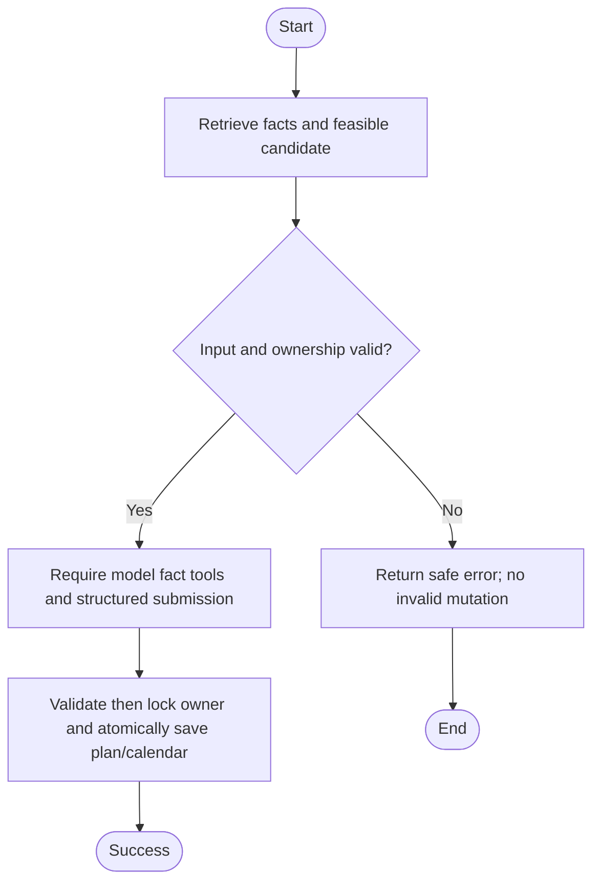

## UC-17 / FR-17: Regenerate after relevant changes

**Request:** `POST {{planningBase}}/plans/{{planId}}/regenerate`

**Input:** `{{planBody}}`

**Success/postcondition:** 201 new version; previous version stays readable.

**Flow:** Load owned previous plan and changed facts → Require previous-plan tool and model revision → Save next version and replace obsolete planned calendar.

**Alternate/error flow:** All completed/deleted work yields empty version; failure preserves prior plan/calendar.

**Code:** PlanningApplicationService.regenerate. **Evidence:** HTTP changed workload, all-completed/deleted and history tests; Postman AI-02 and final-completion regeneration.

## UC-18 / FR-18: Reject invalid model plan

**Request:** `POST {{planningBase}}/plans`

**Input:** `{{planBody}} with deliberately malformed local provider output`

**Success/postcondition:** 400; no plan or calendar mutation.

**Flow:** Model submits structured items → Check exact fields, types, ownership, dates and capacities → Reject violation before persistence.

**Alternate/error flow:** A valid result proceeds normally; provider faults are distinct 503 errors.

**Code:** AgenticPlanningAdvisor.execute / PlanningApplicationService.validateItems. **Evidence:** verify-readiness.py fractional, string, missing field, extra field and out-of-week fixture checks; PlanningValidationTest.

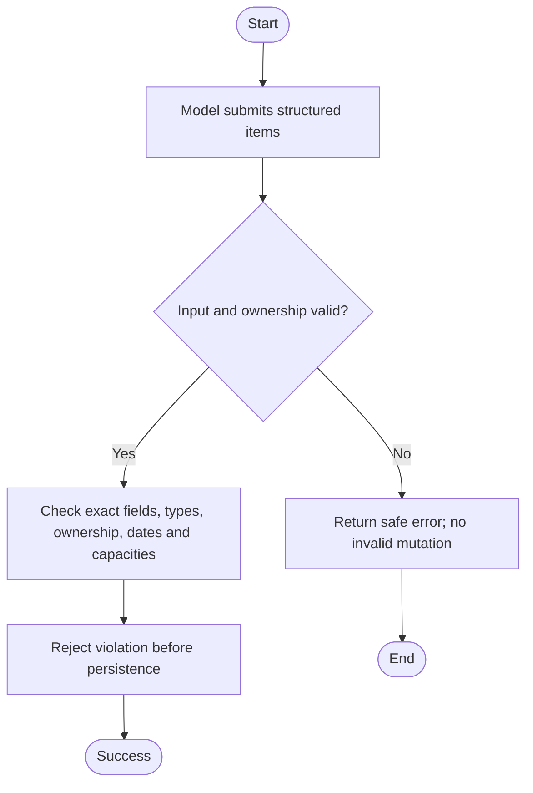
